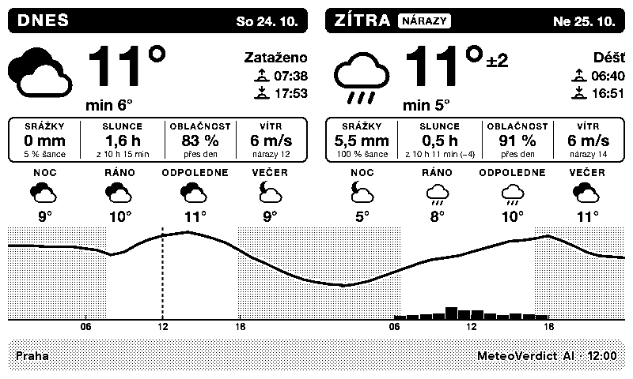
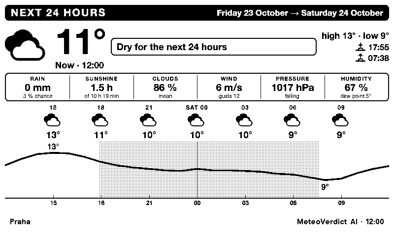
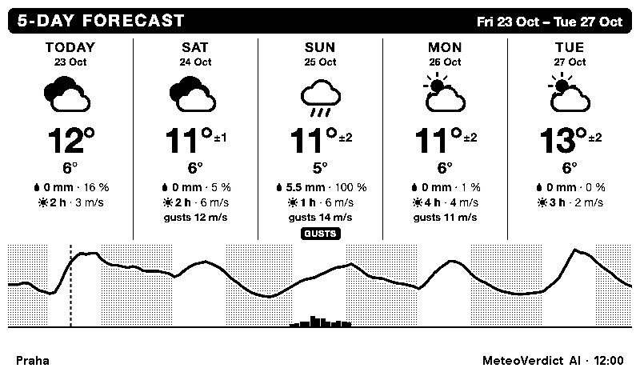
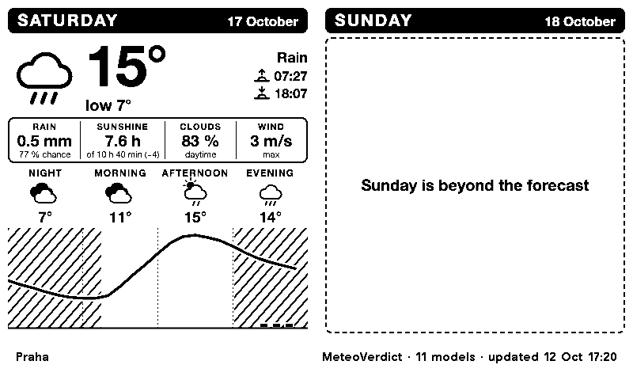
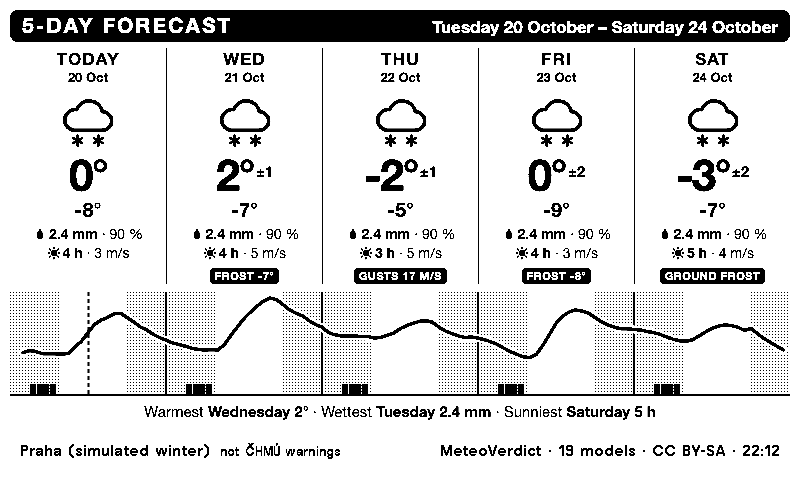
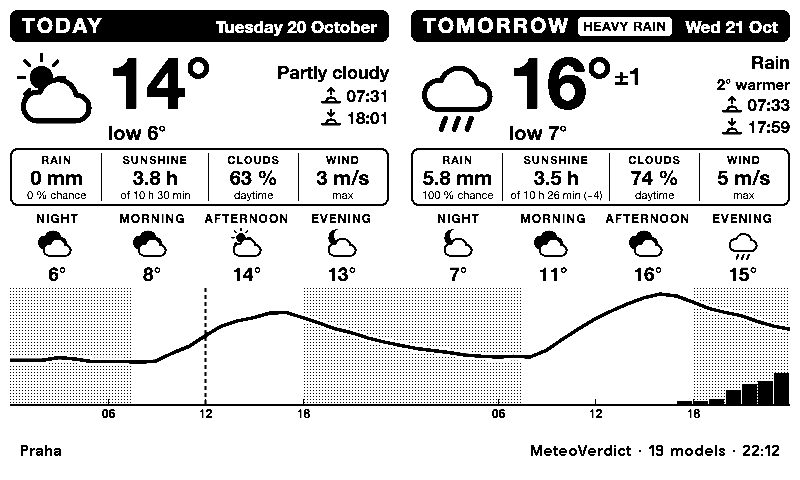
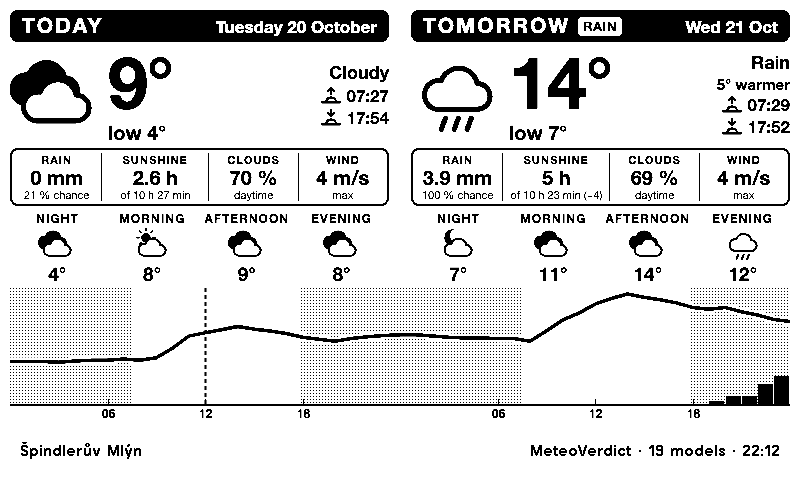
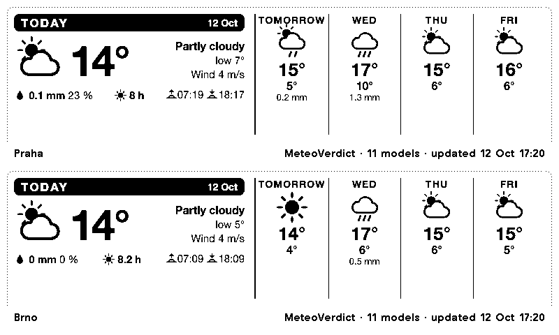
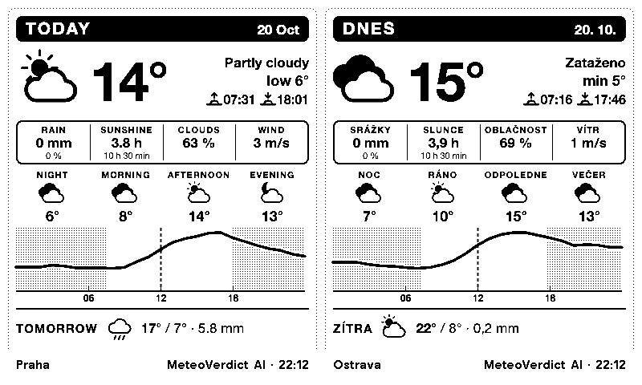
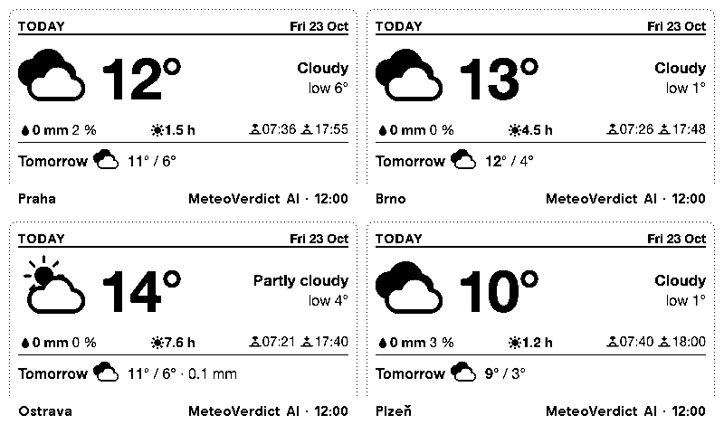

# MeteoVerdict for TRMNL

Weather for your Czech district on a [TRMNL](https://trmnl.com) e-ink display: today and
tomorrow, the next 24 hours, five days or the weekend, with temperature and its range,
rain with its timing and chance, sunshine, clouds, wind, sunrise and sunset, and badges
for frost, rain, gusts and heat. In English or Czech.



The forecast is [MeteoVerdict](https://meteoverdict.cz/)'s. Every day,
MeteoVerdict checks how well about 20 weather models forecast what ČHMÚ stations then
measured, and blends them, weighting each model by how accurate it has been in your okres
over the last 90 days. So you get a forecast tuned for where you live rather than one
model's opinion. Free, no API key.

**New in October 2026**
- **MeteoVerdict AI:** temperature and wind come from MeteoVerdict's own AI model (the
  default), everything else from the combined forecast; or pick the combined forecast of
  all models. The footer says which one you are looking at.
- **The range of the temperature:** with the combined forecast, from tomorrow on, the
  high comes with its "±", half of MeteoVerdict's 80 % range (*16° ±2*).
- **Thresholds from MeteoVerdict itself:** the badges use the same flags as the website
  (*Frost* from the corrected night minimum or the ground, *Rain* when heavy rain is likely,
  gusts over 13.5 m/s).
- **Your obec instead of the okres:** the temperature, rain and wind of any of 6,258
  municipalities, corrected for its elevation, with MeteoVerdict AI or the combined forecast.
- **Rain with its chance and day:** *Rain from tomorrow 16:00 · 1.5 mm · 23 % chance*.
- **A cleaner chart:** drawn pixel for pixel for the panel, with the night as a light
  dot screen, an hour axis and larger rain bars.

## Views

A weather display gets a glance on your way out, so each view answers one question:
*what's today like, and tomorrow?*, *when will it rain?*, *what does the week look like?*,
*what about the weekend?* Pick the view for the full screen in the plugin's settings.

### Today and tomorrow

Two days side by side. For each:
- the symbol, high and low (with the combined forecast, tomorrow's high with its ±), and a one-word summary;
- rain with its chance, hours of sunshine out of the day's daylight (and how many minutes
  longer or shorter the day is than the day before: *of 10 h 26 min (−3)*), cloud cover
  and wind;
- sunrise and sunset, and for the second day how much warmer or colder it gets;
- night, morning, afternoon and evening, each with its own symbol;
- under both days, one hourly temperature curve from edge to edge, with rain bars, the
  night dotted, a dashed line at the current time and the hours 06, 12 and 18 under each day;
- up to two threshold badges in the day's head.

After 18:00 the screen moves on to tomorrow and the day after, since by then that's what
you want to know. This can be switched off in the settings.

### Next 24 hours



For "do I need an umbrella?":
- the temperature now and, when it's cold and windy, how it feels (wind chill);
- a plain sentence about rain, with the amount and the chance: *Rain from 15:00 · 2 mm ·
  60 % chance*, *Rain until 20:00*, *Rain from tomorrow 07:00*, or *Dry for the next 24 hours*;
- the best two hours to be outside: daylight, dry, sunny, near 21 °C and calm;
- the next sunset and sunrise, and tomorrow in one line;
- every 3 hours, a symbol, the temperature and the rain, over the hourly curve.

### 5 days



For planning the week:
- each day's symbol, high (with the combined forecast, its ± from tomorrow on) and low, rain, sunshine and wind;
- one continuous temperature curve over the five days, rain bars under it;
- a closing line naming the warmest, wettest and sunniest day.

### Weekend



Saturday and Sunday side by side, each like a day of *Today and tomorrow*. From Monday to
Friday it shows the coming weekend, on Saturday this one, and on Sunday Sunday and Monday.
With the evening switch on, from 18:00 it looks a day further: on Saturday evening Sunday
and Monday, and on Sunday evening the next weekend.
The forecast reaches five days past today, so early in the week Sunday (or the whole
weekend) can be beyond it: the screen then shows what there is and says *Sunday is beyond
the forecast*. When neither day is in the forecast yet (as on Sunday evening, until
Monday's forecast arrives), it shows the next two days instead, under a small note:
*Weekend not in the forecast yet*.

### Czech

Every view also comes in Czech (*Language: Čeština*), with Czech day and month names and
decimal commas. Screenshots: [today and tomorrow](screenshots/today-tomorrow-cs.png),
[next 24 hours](screenshots/next-24-hours-cs.png), [5 days](screenshots/five-days-cs.png),
[weekend](screenshots/weekend-cs.png).

### Thresholds



*Simulated winter data, to show the badges.*

A day gets up to two badges, from MeteoVerdict's own threshold flags:

| Badge | When |
|---|---|
| Frost / Mráz | MeteoVerdict's corrected night minimum (the night ending that morning) is 1 °C or less, or the ground (5 cm) is forecast to reach 0 °C or below |
| Rain / Déšť | MeteoVerdict's calibrated chance of at least 5 mm in a part of the day is high enough to flag it |
| Gusts / Nárazy | The strongest gust of the day is 13.5 m/s or more; shows it, in your wind unit |
| Hot / Vedro | 30 °C or more |

These are MeteoVerdict's thresholds on its forecast, **not official ČHMÚ warnings**.
Official warnings: [chmi.cz](https://www.chmi.cz/).
(Older data without the flags falls back to the previous rules: a low of 0 °C, 10 mm of
rain, an hourly mean wind of 10 m/s.)

### MeteoVerdict AI or the combined forecast



By default (*Forecast: MeteoVerdict AI*), temperature and wind come from MeteoVerdict's
own AI model, as on the website, and everything else (rain, clouds, sunshine, symbols,
gusts, frost) from the combined forecast; the footer says *MeteoVerdict AI*. The AI is
still experimental and has no "±". With *Forecast: MeteoVerdict (all models combined)*
everything is the combined forecast, which is checked against the stations every day,
the highs from tomorrow on come with their ±, and the footer says *MeteoVerdict · 19
models* (above).

### An obec



For a hilly okres the okres's one forecast point can be far from your village. MeteoVerdict
also forecasts every obec, corrected for its elevation, with MeteoVerdict AI and with the
combined forecast (still a test on the website). With an obec, the temperature, rain and
wind (and the frost badges) are the obec's; the sky, sunshine and chance of rain stay the
okres's. The footer shows the obec's name. See [Install](#an-obec-private-plugins) for
how to set it up.

## Sharing the screen

TRMNL can split the screen between plugins. Each split size has its own compact layout,
so you can show two or four places at once, or the weather next to your calendar.

| Half, wide: today and the next four days | Half, tall: today in detail, tomorrow in a line |
|---|---|
|  |  |

| Quarter: today at a glance, tomorrow in a line |
|---|
|  |

The half and quarter layouts also say how much longer or shorter today is than the day
before: the tall half under its sunshine (*10 h 55 min (−3)*), the wide half and the
quarter after the sunset time (*18:15 (−3)*).

## Install

Add it to your TRMNL as a private plugin. That takes about five minutes.

1. In TRMNL go to **Plugins → Private Plugin → Add new**, name it, e.g. *MeteoVerdict*.
2. **Strategy:** Polling. **Polling URL:**

   ```
   https://meteoverdict.cz/api/v1/{{ forecast_model }}/{{ okres_code }}.json
   ```

   `{{ forecast_model }}` and `{{ okres_code }}` are filled in from the form in step 3.
   (Installed before October 2026 with `…/api/v1/okresy/{{ okres_code }}.json`? That
   still works and is the combined forecast; switch to the URL above for MeteoVerdict AI.)
3. **Form fields:** paste [`src/settings.yml`](src/settings.yml), then save, fill in the
   form and save again. It creates these fields:

   | Field | |
   |---|---|
   | About This Plugin | The description and links. Nothing to fill in |
   | Okres | A dropdown of all 77. Required |
   | Forecast | MeteoVerdict AI, the default, or MeteoVerdict (all models combined) |
   | View | What the full screen shows: today and tomorrow, next 24 hours, 5 days, or the weekend |
   | Place name | Shown in the footer instead of the okres (or obec) name. Optional |
   | Move on to tomorrow in the evening | After 18:00 the day layouts show tomorrow and the day after, and the weekend view looks a day ahead. On by default |
   | Wind speed in | m/s or km/h |
   | Language | English or Czech |
4. **Edit Markup:** paste each file from [`dist/`](dist) into its tab:

   | Tab | File |
   |---|---|
   | Full | [`full.liquid`](dist/full.liquid) |
   | Half Horizontal | [`half_horizontal.liquid`](dist/half_horizontal.liquid) |
   | Half Vertical | [`half_vertical.liquid`](dist/half_vertical.liquid) |
   | Quadrant | [`quadrant.liquid`](dist/quadrant.liquid) |

   Then click **Force Refresh**. (TRMNL takes at most 100 kB per tab; the build keeps
   every file under 95 kB.)
5. **Refresh rate:** hourly. The forecast itself changes a few times a day, but the
   24-hour view and the "now" line move with the clock.
6. Add the plugin to a playlist, or to a mashup.

### An obec (private plugins)

Write the two URLs out in full as the polling URL, one per line: the okres file, then the
obec's. TRMNL passes both files to the layouts, which use the obec's temperature, rain and
wind and show its name. With MeteoVerdict AI (both files from `ai/`):

```
https://meteoverdict.cz/api/v1/ai/okresy/CZ0525.json
https://meteoverdict.cz/api/v1/ai/obce/CZ0525/spindleruv-mlyn.json
```

With the combined forecast, the same without `ai/`.

Both lines name the obec's okres (`CZ0525` above); the Okres and Forecast fields of the
form are not used then. The obec's address is its okres code and
its name in lower case without diacritics, with `-` for spaces (`CZ0201/benesov`,
`CZ0525/spindleruv-mlyn`; a repeated name in one okres gets `-2`, `-3`). The
[Data page](https://meteoverdict.cz/data.html#trmnl) finds it for you
and lists all obce in [`api/v1/obce/index.json`](https://meteoverdict.cz/api/v1/obce/index.json).
If the obec's file doesn't match the okres file (another okres, or a forecast run apart),
the layouts fall back to the okres.

Times are Czech time (CET, or CEST in summer), hour by hour, whatever your TRMNL
account's time zone. The forecast is for Czechia, so that is the clock it should be read
by.

## Publishing

The plugin is not published as a TRMNL recipe; install it as a private plugin as above.
[`recipe/README.md`](recipe/README.md) keeps the notes for publishing it later: the icon,
the texts for TRMNL's forms, a checklist, and where it stands against TRMNL's recipe
requirements (its own styles exceed the linter's limit on inline layout styles).

## What's on the screen, and how far to trust it

| Value | Where it comes from |
|---|---|
| Temperature, wind | MeteoVerdict AI (experimental), by default; with the combined forecast, MeteoVerdict's blend of about 20 models, weighted and bias-corrected per okres and lead day ([methodology](https://github.com/JerryWoof/MeteoVerdict/blob/main/docs/methodology.md)) |
| Rain | MeteoVerdict's blend, as above |
| ± of the high | Half of the 80 % range of the blend's temperature at the day's warmest hour: the true high falls inside the range about 8 times in 10 |
| Chance of rain | MeteoVerdict's chance of rain for each part of the day; the 24-hour sentence takes the highest of the parts it covers |
| Clouds, sunshine | The mean of the models, corrected against ČHMÚ observations |
| Thresholds | MeteoVerdict's flags in the open data: frost and ground frost from the corrected night minimum, heavy rain from the calibrated chance of 5 mm, gusts corrected against ČHMÚ gust observations |
| Obec | MeteoVerdict AI or the blend at the obec's own point, corrected for its elevation (the okres's stations check it only indirectly) |
| Sunrise, sunset | Calculated for the okres's forecast point (NOAA solar equations) |
| Day and part-of-day symbols | MeteoVerdict's: rain, sleet or snow when likely; showers at a 30 % chance; otherwise by cloud cover |
| Hourly symbols (next 24 hours) | The plugin's own, per hour: rain, sleet or snow from 0.5 mm, showers from 0.1 mm, otherwise clear under 25 % cloud, partly cloudy under 70 % |
| Feels like | Wind chill (Environment Canada formula), at 10 °C or below with wind over 4.8 km/h |

The full-screen footer shows which forecast it is (*MeteoVerdict AI*, or *MeteoVerdict ·
19 models* for the combined forecast) and when it was made. The half and quarter footers
show only the time, plus the date if the forecast isn't from today. A forecast older than
30 hours gets an *old forecast* badge. If the data has nothing left for today, the screen
says so instead of showing an old day.

The forecast starts at midnight UTC, so today's first hour is 01:00 (02:00 in summer);
the curve is held level from the left edge to that hour.

## Develop

```bash
npm ci
npm run build                 # src/ → dist/ (inlines the includes)
npm test                      # every layout, view and language against saved data (the blend,
                              # the AI's file, an obec), plus Ruby Liquid vs liquidjs
node scripts/render.mjs out.html --view next_24h --okres CZ0642 --lang cs
node scripts/render.mjs out.html --ai 1 --obec CZ0525/spindleruv-mlyn
npm run screenshots           # screenshots/ with headless Chrome (live data)
npm run settings              # regenerate src/settings.yml from MeteoVerdict's okres list
```

- **Edit in `src/`.** `src/shared.liquid` holds the settings, the polling inputs (one file,
  or `IDX_0` and `IDX_1` with an obec), the labels in both languages, the icons and the
  styles. `src/views/` holds the four full-screen views, and `src/partials/` the pieces
  they share: a day's numbers, two days side by side, the icons, the hourly chart, the
  threshold badges and the footer.
- **Pixel-exact charts.** The charts are SVGs at their real size on the 800 × 480 panel
  (no stretched viewBox), so the night's dot screen and the lines land on whole pixels.
- **`dist/` is for pasting.** TRMNL wants one self-contained template per layout, so
  `npm run build` inlines every `` and strips the comments. Commit `dist/`
  together with `src/`. The layouts leave out the `view view--full` (etc.) wrapper,
  because TRMNL adds it. `scripts/render.mjs` adds it too.
- **Recipe checks.** `scripts/recipe.test.mjs` runs the checks of TRMNL's recipe linter
  that can run locally, and prints the inline-style count it limits.
- **Two Liquid engines.** Rendering and most tests use [liquidjs](https://liquidjs.com), but
  TRMNL runs Ruby Liquid. So `scripts/render.rb` renders the same layouts with the `liquid`
  gem in strict mode, and a test checks that both engines produce the same text. CI
  installs Ruby for this. The templates stick to what both engines support: for example,
  no filters inside `if` conditions or `[]` indices.
- **Data:** the open data files are documented in MeteoVerdict's
  [open data docs](https://github.com/JerryWoof/MeteoVerdict/blob/main/docs/open-data.md).
  The October 2026 refresh is planned in [`docs/plan-2026-10-refresh.md`](docs/plan-2026-10-refresh.md).

## Data sources and licences

- **Code:** [MIT](LICENSE).
- **Forecast data:** © MeteoVerdict, [CC BY-SA 4.0](https://creativecommons.org/licenses/by-sa/4.0/),
  including the MeteoVerdict AI output. It is built from [Open-Meteo.com](https://open-meteo.com/)
  (CC BY 4.0) with the models of DWD, ECMWF, NOAA, Météo-France, GeoSphere Austria, KNMI,
  DMI, ČHMÚ, Environment and Climate Change Canada, the Japan Meteorological Agency, the
  China Meteorological Administration and the UK Met Office (CC BY-SA 4.0), and from ČHMÚ
  observations (CC BY 4.0). Boundaries: ČÚZK (CC BY 4.0). Obec elevations: Copernicus DEM
  GLO-90. The footer of every layout credits MeteoVerdict.
- **Non-commercial.** MeteoVerdict uses Open-Meteo's free, non-commercial API, so this
  plugin is free and without ads, and stays that way.
- **Thresholds, not warnings.** Only ČHMÚ issues weather warnings in Czechia (Act 262/2024
  Sb.); the badges are MeteoVerdict's thresholds.

A non-commercial, independent project, not affiliated with TRMNL, ČHMÚ or Open-Meteo.
