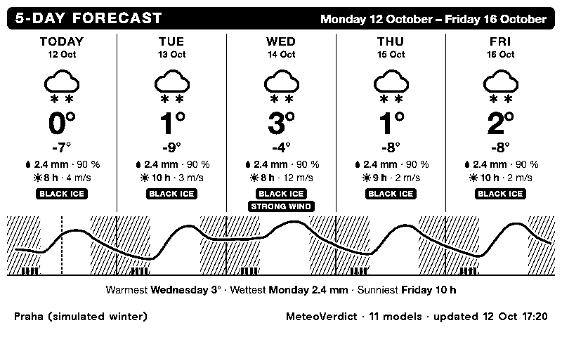
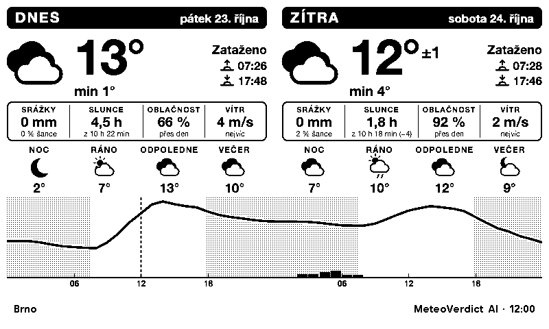

# MeteoVerdict for TRMNL

Weather for your Czech district on a [TRMNL](https://trmnl.com) e-ink display: today and
tomorrow, the next 24 hours, five days or the weekend, with temperature, rain, sunshine, clouds, wind,
sunrise and sunset. In English or Czech.


The forecast is [MeteoVerdict](https://jerrywoof.github.io/MeteoVerdict/)'s. Every day,
MeteoVerdict checks how well 11 weather models forecast what ČHMÚ stations then measured,
and blends them, weighting each model by how accurate it has been in your okres over the
last 90 days. So you get a forecast tuned for where you live rather than one model's
opinion. Free, no API key.

## Views

A weather display gets a glance on your way out, so each view answers one question:
*what's today like, and tomorrow?*, *when will it rain?*, *what does the week look like?*,
*what about the weekend?*
Pick the view for the full screen in the plugin's settings.

### Today and tomorrow

Two days side by side. For each:
- the symbol, high and low, and a one-word summary;
- rain with its chance, hours of sunshine out of the day's daylight (and how many minutes
  longer or shorter the day is than the day before: *of 10 h 55 min (−3)*), cloud cover
  and wind;
- sunrise and sunset, and for the second day how much warmer or colder it gets;
- night, morning, afternoon and evening, each with its own symbol;
- the hourly temperature curve, with rain bars, the night hatched and a dashed line at the
  current time.

After 18:00 the screen moves on to tomorrow and the day after, since by then that's what
you want to know. This can be switched off in the settings.

### Next 24 hours


For "do I need an umbrella?":
- the temperature now and, when it's cold and windy, how it feels (wind chill);
- a plain sentence about rain: *Rain from 15:00*, *Rain until 20:00*, or *Dry for the next
  24 hours*;
- the best two hours to be outside: daylight, dry, sunny, near 21 °C and calm;
- the next sunset and sunrise, and tomorrow in one line;
- every 3 hours, a symbol, the temperature and the rain, over the hourly curve.

### 5 days


For planning the week:
- each day's symbol, high and low, rain, sunshine and wind;
- one continuous temperature curve over the five days;
- a closing line naming the warmest, wettest and sunniest day.

### Weekend


Saturday and Sunday side by side, each like a day of *Today and tomorrow*. From Monday to
Friday it shows the coming weekend, on Saturday this one, and on Sunday Sunday and Monday.
With the evening switch on, from 18:00 it looks a day further: on Saturday evening Sunday
and Monday, and on Sunday evening the next weekend.
The forecast reaches five days past today, so early in the week Sunday (or the whole
weekend) can be beyond it: the screen then shows what there is and says *Sunday is beyond
the forecast*, as above on a Monday. When neither day is in the forecast yet (as on
Sunday evening, until Monday's forecast arrives), it shows the next two days instead,
today and tomorrow (or tomorrow and the day after in the evening), under a small note:
*Weekend not in the forecast yet*.

### Warnings



*Simulated winter data, to show the badges.*

A day gets up to two badges:

| Badge | When |
|---|---|
| Black ice / Náledí | An hour at or below 0.5 °C with precipitation |
| Frost / Mráz | The low is at or below 0 °C |
| Heavy rain / Vydatně prší | 10 mm or more |
| Strong wind / Silný vítr | An hourly mean of 10 m/s (36 km/h) or more |
| Hot / Vedro | 30 °C or more |

These are thresholds on the forecast, not official ČHMÚ warnings.

### Czech



Every view also comes in Czech (*Jazyk: Čeština*), with Czech day and month names and
decimal commas.

## Sharing the screen

TRMNL can split the screen between plugins. Each split size has its own compact layout,
so you can show two or four places at once, or the weather next to your calendar.

| Half, wide: today and the next four days | Half, tall: today in detail, tomorrow in a line |
|---|---|
|  |  |

| Quarter: today at a glance, tomorrow in a line |
|---|
|  |

The half and quarter layouts also say how much longer or shorter today is than the day
before: the tall half under its sunshine (*10 h 55 min (−3)*), the wide half and the
quarter after the sunset time (*18:15 (−3)*). As on the full screen, the change is left
out when the forecast does not have the day before.

## Install

MeteoVerdict is being prepared as a public TRMNL recipe (see [Publishing](#publishing)).
Until it's out, or if you'd rather have your own copy of the markup, add it as a private
plugin. That takes about five minutes.

1. In TRMNL go to **Plugins → Private Plugin → Add new**, name it, e.g. *MeteoVerdict*.
2. **Strategy:** Polling. **Polling URL:**

   ```
   https://jerrywoof.github.io/MeteoVerdict/api/v1/okresy/{{ okres_code }}.json
   ```

   `{{ okres_code }}` is filled in from the form in step 3.
3. **Form fields:** paste [`src/settings.yml`](src/settings.yml), then save, fill in the
   form and save again. It creates these fields:

   | Field | |
   |---|---|
   | About This Plugin | The description and links. Nothing to fill in |
   | Okres | A dropdown of all 77. Required |
   | View | What the full screen shows: today and tomorrow, next 24 hours, 5 days, or the weekend |
   | Place name | Shown in the footer instead of the okres name. Optional |
   | Move on to tomorrow in the evening | After 18:00 the day layouts show tomorrow and the day after, and the weekend view looks a day ahead (Sunday and Monday on Saturday evening, the next weekend on Sunday evening). On by default |
   | Wind speed in | m/s or km/h |
   | Language | English or Czech |
4. **Edit Markup:** paste each file from [`dist/`](dist) into its tab:

   | Tab | File |
   |---|---|
   | Full | [`full.liquid`](dist/full.liquid) |
   | Half Horizontal | [`half_horizontal.liquid`](dist/half_horizontal.liquid) |
   | Half Vertical | [`half_vertical.liquid`](dist/half_vertical.liquid) |
   | Quadrant | [`quadrant.liquid`](dist/quadrant.liquid) |

   Then click **Force Refresh**.
5. **Refresh rate:** hourly. The forecast itself changes twice a day, but the 24-hour view
   and the "now" line move with the clock.
6. Add the plugin to a playlist, or to a mashup.

Times are Czech time (CET, or CEST in summer), hour by hour, whatever your TRMNL
account's time zone. The forecast is for Czechia, so that is the clock it should be read
by.

## Publishing

[`recipe/README.md`](recipe/README.md) has everything for submitting the plugin as a
public TRMNL recipe: the icon, the texts for TRMNL's forms, a step-by-step checklist, and
where the plugin stands against each of TRMNL's recipe requirements.

## What's on the screen, and how far to trust it

| Value | Where it comes from |
|---|---|
| Temperature, rain, wind | MeteoVerdict's blend of 11 models, weighted and bias-corrected per okres and lead day ([methodology](https://github.com/JerryWoof/MeteoVerdict/blob/main/docs/methodology.md)) |
| Chance of rain | The weighted share of the models that forecast at least 0.2 mm for that period |
| Clouds, sunshine | The plain average of the models. Not checked against observations, and the models disagree a lot on sunshine |
| Sunrise, sunset | Calculated for the okres's forecast point (NOAA solar equations) |
| Day and part-of-day symbols | MeteoVerdict's: rain, sleet or snow when likely; showers at a 30 % chance; otherwise by cloud cover |
| Hourly symbols (next 24 hours) | The plugin's own, per hour: rain, sleet or snow from 0.5 mm, showers from 0.1 mm, otherwise clear under 25 % cloud, partly cloudy under 70 % |
| Feels like | Wind chill (Environment Canada formula), at 10 °C or below with wind over 4.8 km/h |

The forecast is for one point per okres, so in a large or hilly okres your village can
differ from it, especially in temperature at night.

The forecast updates at about 06:00 and 18:00 UTC. The full-screen footer shows when it
was last updated and how many models went into it. The half and quarter footers show only
the time, plus the date if the forecast isn't from today. A forecast older than 30 hours
gets an *old forecast* badge. If the data has nothing left for today, the screen says so
instead of showing an old day.

Today's curve starts at 01:00 (02:00 in summer), because the forecast starts at
midnight UTC.

## Develop

```bash
npm ci
npm run build                 # src/ → dist/ (inlines the includes)
npm test                      # every layout, view and language against saved data, plus
                              # Ruby Liquid vs liquidjs (when ruby and the liquid gem are there)
node scripts/render.mjs out.html --view next_24h --okres CZ0642 --lang cs
npm run screenshots           # screenshots/ with headless Chrome (live data)
npm run settings              # regenerate src/settings.yml from MeteoVerdict's okres list
```

- **Edit in `src/`.** `src/shared.liquid` holds the settings, the labels in both languages,
  the icons and the styles. `src/views/` holds the four full-screen views, and
  `src/partials/` the pieces they share: a day's numbers, two days side by side, the
  icons, the hourly chart and the footer.
- **`dist/` is for pasting.** TRMNL wants one self-contained template per layout, so
  `npm run build` inlines every `` and strips the comments. Commit `dist/`
  together with `src/`. The layouts leave out the `view view--full` (etc.) wrapper,
  because TRMNL adds it. `scripts/render.mjs` adds it too.
- **Recipe checks.** `scripts/recipe.test.mjs` runs the checks of TRMNL's recipe linter
  that can run locally, and prints the inline-style count it limits.
- **Two Liquid engines.** Rendering and most tests use [liquidjs](https://liquidjs.com), but
  TRMNL runs Ruby Liquid. So `scripts/render.rb` renders the same layouts with the `liquid`
  gem in strict mode, and a test checks that both engines produce the same text. CI
  installs Ruby for this. The templates stick to what both engines support: for example,
  no filters inside `if` conditions or `[]` indices.
- **Data:** the open data files are documented in MeteoVerdict's
  [open data docs](https://github.com/JerryWoof/MeteoVerdict/blob/main/docs/open-data.md).

## Licence

- **Code:** [MIT](LICENSE).
- **Forecast data:** © MeteoVerdict, [CC BY-SA 4.0](https://creativecommons.org/licenses/by-sa/4.0/).
  It is built from [Open-Meteo.com](https://open-meteo.com/) (CC BY 4.0) with models of
  DWD, ECMWF, NOAA, Météo-France, GeoSphere Austria, KNMI, DMI, ČHMÚ and the UK Met
  Office, and from ČHMÚ observations (CC BY 4.0). The footer of every layout credits
  MeteoVerdict.

A non-commercial, independent project, not affiliated with TRMNL, ČHMÚ or Open-Meteo.
