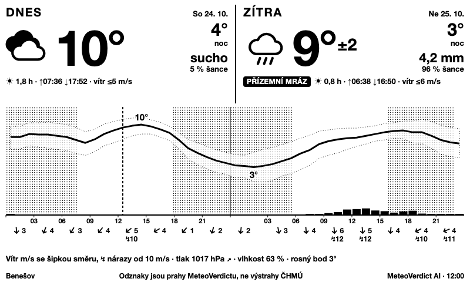
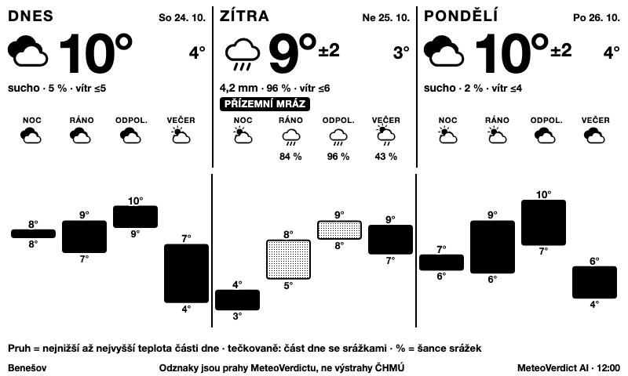
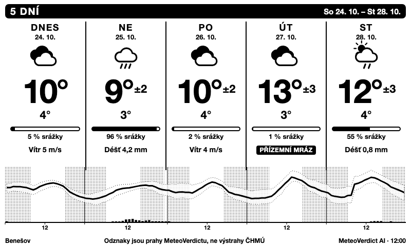

# Návrh: nový dashboard MeteoVerdict AI (2, 3 a 5 dní)

**Jen návrh.** Do `dist/` ani `src/` se nic nezměnilo, dokud vlastník nevybere variantu.
Mockupy jsou statické (800×480, černobíle) a vykreslují reálná AI data z
`test/fixtures/2026-10-23-CZ0201-ai.json` (Benešov, „teď“ = 24. 10. 12:00). Generuje je
[`build.mjs`](build.mjs) (`node docs/proposal/build.mjs`).

| Varianta | Mockup | Hlavní myšlenka |
|---|---|---|
| 2 dny | [2-days.png](2-days.png) · [html](2-days.html) | hodinový průběh: *kdy* bude co |
| 3 dny | [3-days.png](3-days.png) · [html](3-days.html) | části dne s teplotním pásem: *jaký* bude den |
| 5 dní | [5-days.png](5-days.png) · [html](5-days.html) | týdenní přehled: *který den stojí za pozornost* |

## Společná pravidla

- **Hierarchie:** největší je vždy maximum dne (60–84 px) a symbol; pod ním minimum, srážky
  (mm a šance) a až pak drobné údaje. Co nehraje roli, se nezobrazí (např. mlha jen
  při pravděpodobnosti ≥ 40 %).
- „±“ u maxima od zítřka (polovina 80% rozpětí AI), jako dnes.
- **Odznaky** (jen to, co je podle prahů MeteoVerdictu pravda): *Nárazy*, *Silný déšť*,
  *Mráz* / *Přízemní mráz*, černý štítek. V patičce je **vždy** věta *Odznaky jsou prahy
  MeteoVerdictu, ne výstrahy ČHMÚ*.
- Patička: místo · upozornění · `MeteoVerdict AI · čas`. Noc je tečkovaná jako dnes.
- Kompaktně: žádné prvky nad rámec dnešních velikostí písma (≥ 11 px jen pro popisky os).

## Proč tři různé obrazovky

**2 dny → hodinový průběh.** Na dnešek a zítřek se lidé ptají „kdy?“ (kdy mi zaprší, kdy
vyrazit, kdy zesílí vítr). Proto je dole jedna křivka teploty s pásem ±, sloupce srážek po
hodinách a pod ní každé 3 hodiny vítr se šipkou směru (nárazy od 10 m/s). Nahoře dva
velké sloupce Dnes/Zítra s maximem, minimem, srážkami a odznaky. Hodinová přesnost se u
2 dnů vyplatí, protože AI hodinová data dává a rozlišení 48 hodin se na 780 px ještě čte.

**3 dny → části dne + teplotní pás.** Třetí den už hodinová křivka nepřidá nic, co
by se nedalo číst z částí dne, a víc než 72 hodin je pro hodinový detail příliš. Každý den
má 4 části (noc, ráno, odpoledne, večer) se symbolem a šancí srážek a dole plovoucí pruhy
tmin–tmax na jedné společné ose přes všechny tři dny, takže se hned vidí, kdy se ochladí
a kdy je největší rozdíl mezi ránem a odpolednem. Je to nejlepší varianta pro plánování
„den po dni“ (děti, zahrada, kolo).

**5 dní → jeden údaj na den.** Pět sloupců po 156 px. Každý má symbol, maximum, minimum,
**pruh šance srážek** (0–100 %) a **jeden nejdůležitější údaj**. Pořadí důležitosti:
nárazy nad prahem → silný déšť → sníh → déšť (od 1 mm nebo šance ≥ 50 %) → mráz → mlha →
slunce (≥ 4 h) → vítr. Nad prahem je to černý odznak, jinak prostý text. Dole souvislá
křivka s pásem ± a srážkami pro celkový obrázek. Na 5 dní se žádné podrobnosti nevyplatí:
předpověď je v dalších dnech nejistější a údaje by jen přeplnily obrazovku.

## Co ukazujeme a co záměrně ne

| Ukazujeme | Záměrně ne |
|---|---|
| teplota (max/min, ±), srážky mm + šance, symbol | tlak jako graf (v 2 dnech jen řádek s trendem), vlhkost a rosný bod jen v řádku pod grafem u 2 dnů |
| vítr + směr + nárazy (2 dny), max vítr (3 a 5 dní) | záření (W/m²), nízká oblačnost: srozumitelné je „slunce h“ |
| východ/západ slunce (2 dny, tečkovaná noc) | CAPE a dohlednost jako čísla: jen jako podmíněný údaj (mlha, bouřky) |
| mráz / přízemní mráz, nárazy, silný déšť (prahy) | teplota 5 cm nad zemí a výška sněhu: jen vedlejší text, když je sníh/mráz |
| sněžení (cm) jako klíčový údaj, když sněží | pravděpodobnost silného deště jako číslo (jen odznak) |

## Která nová pole jdou do šablon

Hodinová pole (`forecast.hourly`): `temperature_2m`, `temperature_2m_lo`/`_hi` (pás a „±“;
šablony je už používají), `precipitation`, `wind_speed_10m` (+ nové `wind_direction_10m`,
`wind_gusts_10m` pro pruh větru ve 2 dnech), `cloud_cover` a `sunshine_duration`
(slunce h), `pressure_msl`, `relative_humidity_2m`, `dew_point_2m` (jen řádek 2 dnů).
Podmíněně (jen AI, jen když mají smysl): `fog_probability` (≥ 0,4 → „Mlha“),
`snowfall` (součet za den ≥ 0,5 cm → „Sníh“), `visibility` (< 5 km → doplněk k mlze),
`cape` (≥ 500 J/kg → „Možné bouřky“, vedlejší text), `temperature_5cm` (pomůcka pro
přízemní mráz, jen když chybí `ground_frost`). Nepoužijí se: `shortwave_radiation`,
`cloud_cover_low`, `snow_depth*`.

Pole částí dne (`forecast.parts`): `tmin`, `tmax`, `symbol`, `rain_probability`,
`precipitation`, `wind`, `gust`, `sunshine`, `sunrise`, `sunset`; odznaky z
`gust_over_threshold`, `heavy_rain`, `frost`, `ground_frost`.

## Co je třeba vědět o datech

- Řádek `part: "day"` v AI souboru nemusí sedět s částmi (např. 25. 10.: „day“ má 0 mm, části
  dohromady 4,2 mm). Mockupy proto počítají denní srážky z hodin a maximum/minimum
  z částí, jako to dělají dnešní šablony.

## Co je potřeba rozhodnout (vlastník)

1. Která varianta (nebo přepínač *View* mezi nimi, jako dnes u pohledů).
2. Zda zachovat i současné pohledy (*Dnes a zítra*, *Příštích 24 hodin*, *5 dní*, *Víkend*).
3. Jazyk: mockupy jsou česky; implementace by držela EN/CS jako dnes.
